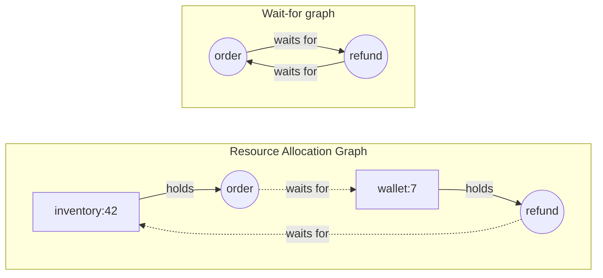
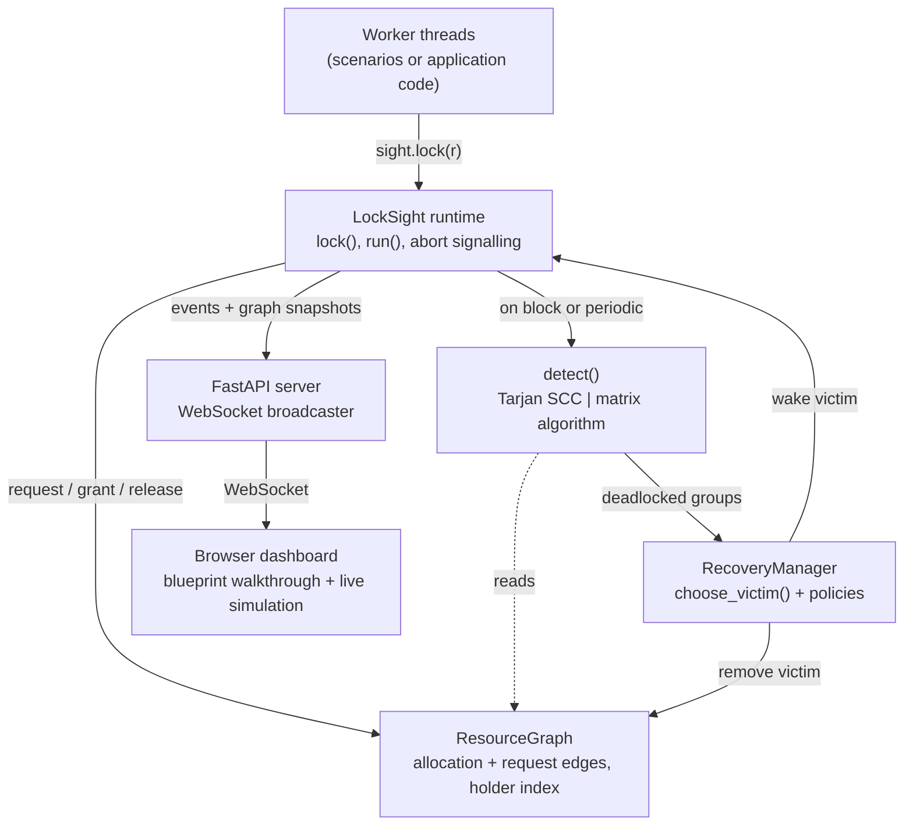
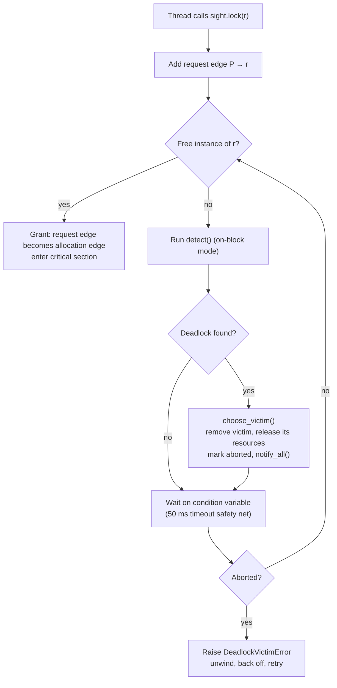
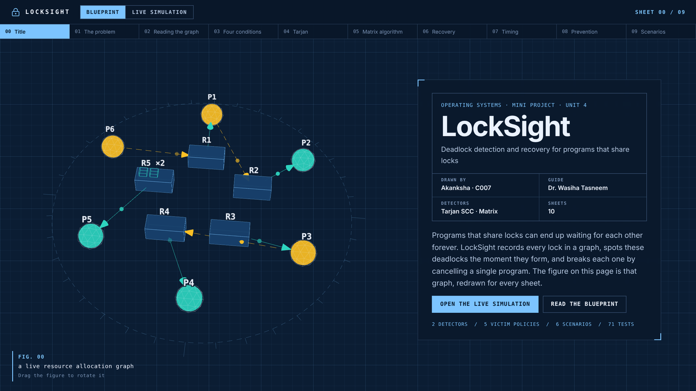
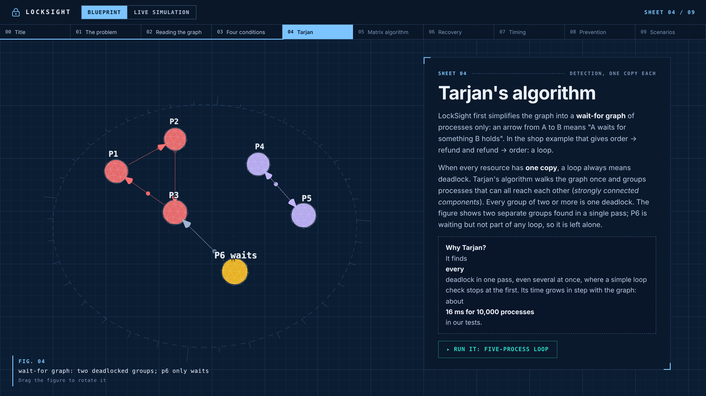
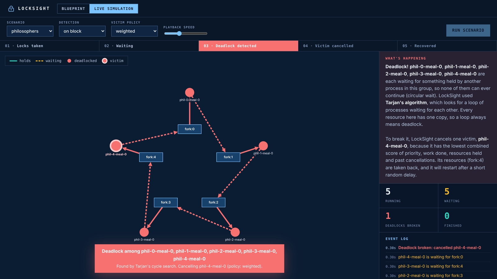
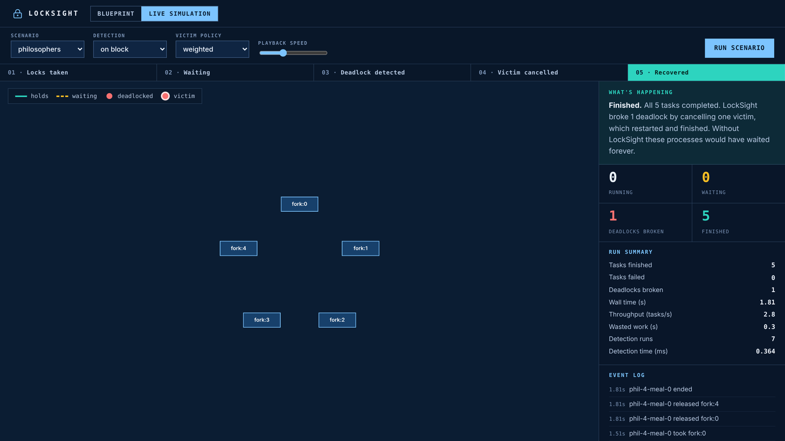
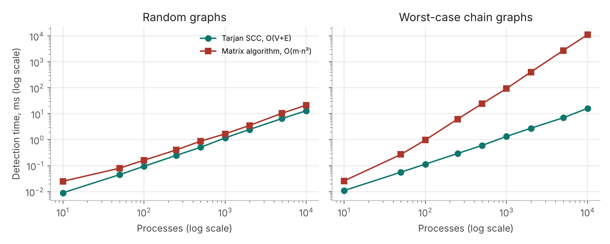
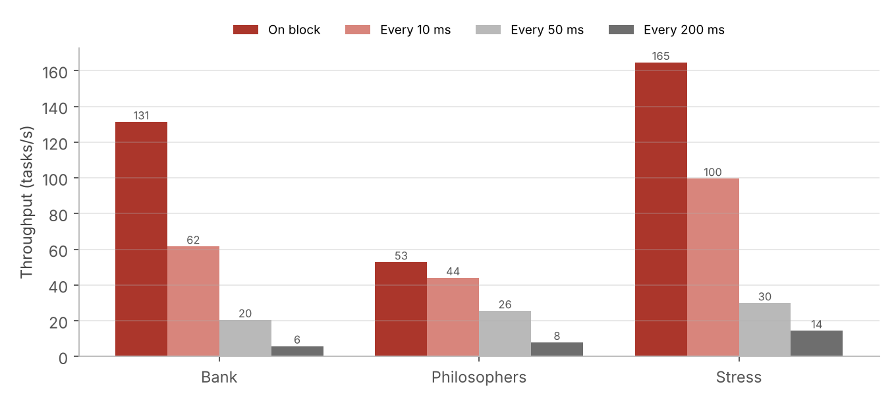
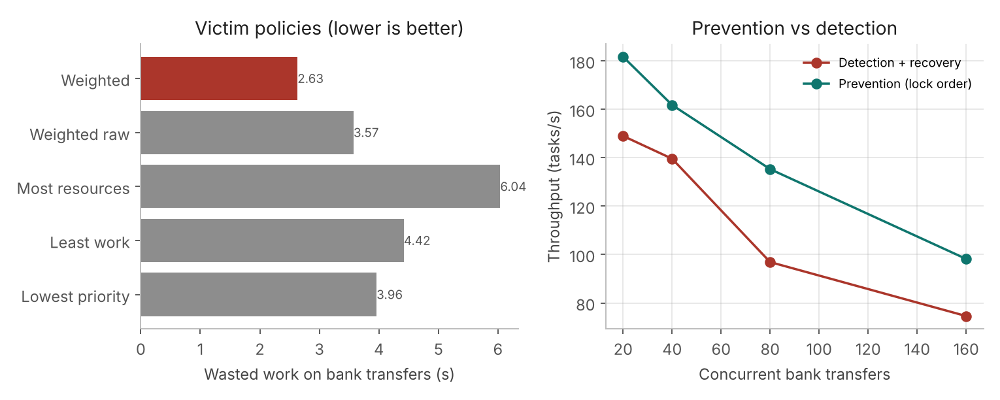

# LockSight: Deadlock Detection and Recovery System

**Operating Systems mini project · Unit 4: Deadlock**

| | |
|---|---|
| **Student** | Akanksha Patil (Roll No. C007) |
| **Programme** | B.Tech Computer Engineering, 3rd year |
| **Institute** | MPSTME, SVKM's NMIMS Hyderabad |
| **Faculty guide** | Dr. Wasiha Tasneem |
| **Academic year** | 2026–27 |

---

## Contents

1. [Abstract](#abstract)
2. [Introduction](#1-introduction)
3. [Theory](#2-theory)
4. [System design](#3-system-design)
5. [Implementation](#4-implementation)
6. [Results and discussion](#5-results-and-discussion)
7. [Conclusion and future work](#6-conclusion-and-future-work)
8. [How to run](#7-how-to-run)
9. [References](#references)

---

## Abstract

Concurrent programs protect shared data with locks, and when two workers acquire the same locks in opposite orders they can wait for each other forever. Databases detect such deadlocks among their own locks, but locks taken in application code (a wallet, an inventory row, a pooled database connection) are usually guarded only by timeouts.

This project presents **LockSight**, a deadlock detection and recovery system for lock-based workloads. Every request, grant and release is recorded in a **Resource Allocation Graph**. Deadlocks are detected with **Tarjan's strongly connected components algorithm** when every resource has a single instance, and with the **matrix-based detection algorithm** when resources have several instances. Recovery aborts **one victim** per deadlock, chosen by one of five cost-based policies with starvation protection; the victim unwinds safely and retries.

The system runs real threads and includes six workload scenarios, a live web dashboard with an interactive explanation of the theory, and **71 automated tests**. Benchmarks show Tarjan-based detection finishing in about 16 ms at 10,000 processes where the matrix algorithm needs 11.3 s in its worst case, on-block detection giving up to 22× the throughput of periodic detection, and lock ordering outperforming detection and recovery by 1.2–1.3× whenever a global lock order can be imposed.

---

## 1. Introduction

### 1.1 Background

Back-end systems handle many requests at the same time. To keep shared data consistent, code takes a **lock** before changing something and releases it afterwards; anyone else who wants it must wait. Locks guarantee mutual exclusion, but they also introduce a classic operating-systems failure: **deadlock**, where a set of processes each hold a resource and wait for a resource held by another member of the set, so none can ever proceed.

### 1.2 Motivation

Consider two services in an online shop:

- The **order** service locks `inventory:42`, then needs `wallet:7` to charge the customer.
- At the same moment, the **refund** service locks `wallet:7`, then needs `inventory:42` to restock.

Each holds what the other needs, so both wait forever. Database engines detect deadlocks among their own row locks, but locks taken in application code are invisible to them. In practice these deadlocks are handled with timeouts, which are:

- **slow**, because every request in the cycle hangs for the full timeout;
- **imprecise**, because slow but healthy requests are cancelled too;
- **uninformative**, because nothing records which locks formed the cycle.

### 1.3 Problem statement

> Design and implement a system that tracks lock requests from concurrent workers in a live Resource Allocation Graph, detects deadlocks among single- and multi-instance resources as they form, and resolves each deadlock automatically by aborting a minimal, fairly chosen victim that then retries, while measuring the cost of detection and recovery against alternatives.

### 1.4 Objectives and scope

1. **Model every lock:** processes, resources (with one or more instances), allocation edges and request edges.
2. **Detect every deadlock** with an algorithm suited to each kind of resource.
3. **Recover safely and fairly:** configurable victim policy, no starvation, no livelock, no killed threads.
4. **Demonstrate and measure:** real threads, realistic scenarios, a live visualisation and quantitative benchmarks.

**Scope:** workers are threads inside one Python process. Tracking locks across separate networked services is future work.

---

## 2. Theory

### 2.1 The four Coffman conditions

A deadlock can occur only if all four hold at the same time:

| Condition | Meaning | In LockSight |
|---|---|---|
| **Mutual exclusion** | Only one process can use a resource at a time | Allowed: it is the purpose of a lock |
| **Hold and wait** | A process holds one resource while waiting for another | Allowed: normal code nests locks |
| **No preemption** | A resource can't be taken away; the holder must release it | **Broken during recovery**: the victim's resources are taken back |
| **Circular wait** | Processes wait for each other in a loop | **Detected** as it forms, then broken |

### 2.2 Strategies for handling deadlock

- **Prevention:** make one condition impossible, usually circular wait, by imposing a global lock order.
- **Avoidance:** grant a request only if the system stays safe (Banker's algorithm). Needs every process's maximum demand in advance.
- **Detection and recovery:** let deadlocks happen, find them and break them. **This is what LockSight does.**
- **Ignore:** rely on restarts.

LockSight uses detection and recovery because application code rarely knows its maximum needs in advance, and a global lock order cannot always be imposed when locks are chosen at run time or owned by different teams. Section 5.5 compares it with prevention.

### 2.3 Resource Allocation Graph and wait-for graph

A **Resource Allocation Graph (RAG)** has process nodes and resource nodes:

- an **allocation edge** `R → P` means P holds an instance of R;
- a **request edge** `P → R` means P is waiting for R.

Keeping only the processes gives a **wait-for graph**: `A → B` means A waits for something B holds.



**Key rule:** when every resource has **one** instance, a cycle in the wait-for graph **always** means deadlock. When a resource has **several** instances, a cycle is necessary but **not sufficient**.

**Example of a cycle that is not a deadlock.** R1 has 2 instances; P1 and P3 each hold one, and P2 holds R2. P1 waits for R2 and P2 waits for R1, forming a cycle. But P3 isn't waiting: it finishes, releases R1, P2 takes it, and the cycle dissolves. A cycle-based detector would raise a false alarm, so multi-instance resources need a different algorithm.

### 2.4 Tarjan's strongly connected components algorithm

A **strongly connected component (SCC)** is a maximal set of nodes where every node can reach every other. Every cycle lies inside one SCC, so in a wait-for graph **each SCC with two or more processes is one deadlocked group**.

Tarjan's algorithm finds all SCCs in one depth-first search. Each node gets an **index** (when it was first visited) and a **lowlink** (the smallest index it can reach through nodes still on the stack). When a node finishes with `lowlink == index`, it is the root of an SCC, and everything above it on the stack is that component.

- **Time:** O(V + E).
- **Advantage over a plain DFS cycle check:** it reports **every** deadlock in one pass instead of stopping at the first.

### 2.5 Matrix-based detection algorithm

For multi-instance resources, the detection algorithm (Silberschatz et al.) asks **"can everyone still finish?"**

1. `Work` = free instances of each resource; `Finish[i]` = true only for processes holding nothing.
2. Find an unfinished process whose `Request` fits within `Work`.
3. Assume it finishes: `Work += Allocation[i]`, `Finish[i] = true`. Repeat.
4. Every process left unfinished is **deadlocked**.

- **Time:** O(m · n²) in the worst case, when each pass frees only one process.

### 2.6 Recovery

A deadlock is broken by **terminating processes** or **preempting resources**. Either way a **victim** must be chosen, considering its priority, the work it would lose, the resources it would free, and how often it has already been chosen. Always choosing the same process causes **starvation**.

---

## 3. System design

### 3.1 Architecture



### 3.2 Modules

| Module | Files | Responsibility |
|---|---|---|
| Core graph | `locksight/core/graph.py` | Processes, resources with instance counts, allocation and request edges, reverse holder index, wait-for graph |
| Detection | `core/detector.py`, `core/matrix_detector.py`, `core/detect.py` | Tarjan SCC, matrix algorithm with grouping, automatic choice of algorithm |
| Recovery | `recovery/policies.py`, `recovery/manager.py` | Five victim policies, starvation protection, abort-one-then-re-detect loop |
| Runtime | `runtime/locksight.py` | Instrumented locks for real threads, safe victim signalling, retry with back-off |
| Simulator | `simulator/workload.py`, `scenarios.py`, `run.py` | Six scenarios, metrics, command-line runner |
| Dashboard | `server/app.py`, `dashboard/` | FastAPI + WebSocket server, blueprint walkthrough, live simulation |
| Evaluation | `benchmarks/`, `tests/` | Four experiments, 71 automated tests, CI |

### 3.3 Flow of a lock request



### 3.4 Key design decisions

- **One victim at a time.** Aborting one process usually breaks the cycle and wastes far less work than aborting the whole group; detection runs again afterwards.
- **Threads are never killed.** Python cannot stop a thread safely, and killing one that holds locks would corrupt shared state. The victim is always blocked inside a lock request, so it observes the abort flag, raises `DeadlockVictimError`, unwinds its `with` blocks and is restarted by `run()`.
- **Random back-off** on restart prevents **livelock**, where victims collide in the same order again and again.
- **One condition variable guards the graph**, so detection always sees a consistent snapshot. The trade-off is that lock bookkeeping is serialised.
- **Every dashboard message carries a full graph snapshot**, so the browser can never drift out of sync.

### 3.5 Assumptions

Workers are threads in one process; resources are registered before use; locks are held until the matching release; an aborted task can restart from its beginning without side effects.

---

## 4. Implementation

### 4.1 Tools and technologies

| Tool | Use |
|---|---|
| Python 3, `threading` | Core, runtime, simulator; `Condition` for waiting and wake-up |
| FastAPI, Uvicorn | Dashboard server, REST endpoints, WebSocket stream |
| Cytoscape.js 3.34.3 | Live graph in the simulation |
| Three.js, GSAP, Lenis | 3D blueprint figure, animation and smooth scrolling |
| matplotlib | Benchmark charts |
| pytest, HTTPX | Unit, multi-threaded and server tests |
| Git, GitHub Actions | Version control; CI on Python 3.11, 3.12 and 3.13 |

All browser libraries are bundled in `dashboard/vendor/`, so the demo works without internet.

### 4.2 Resource graph with a holder index

Granting a request turns a request edge into an allocation edge. A reverse index (`held_by`, `allocated`) makes `holders(r)` and `available(r)` direct lookups; it was added after benchmarking exposed a quadratic bottleneck (Section 5.2).

```python
def grant(self, pid, rid, count=1):
    if self.request[pid].get(rid, 0) < count:
        raise GraphError(f"{pid} has no pending request for {count} of {rid}")
    if self.available(rid) < count:
        raise GraphError(f"Only {self.available(rid)} of {rid} available")
    self.request[pid][rid] -= count
    if self.request[pid][rid] == 0:
        del self.request[pid][rid]
    self.allocation[pid][rid] += count
    self.held_by[rid][pid] = self.allocation[pid][rid]   # reverse index
    self.allocated[rid] += count
```

### 4.3 Iterative Tarjan

The detector uses an explicit stack instead of recursion, because Python's default recursion limit (about 1,000) would crash on large graphs; a test checks a 5,000-process cycle.

```python
# node is the root of an SCC: pop the whole component
if lowlink[node] == index_of[node]:
    component = set()
    while True:
        member = scc_stack.pop()
        on_stack.discard(member)
        component.add(member)
        if member == node:
            break
    sccs.append(component)
```

`detect()` uses Tarjan when every resource has one instance, and the matrix algorithm otherwise.

### 4.4 Victim selection

| Policy | Cancels the process that… | Good for |
|---|---|---|
| **Weighted** (default) | has the lowest combined score: priority + work − resources held + past aborts, **each scaled to 0–1** within the group | A balance of everything |
| Lowest priority | is least important | Protecting important work |
| Least work | has done the least work | Wasting the least effort |
| Most resources | holds the most | Freeing the most at once |
| Weighted raw | same score, unscaled | Comparison only |

The first combined policy (kept as *weighted raw*) added raw values; since priority runs 0–9 and work is in fractions of a second, priority dominated. Scaling fixed this.

**Starvation protection** and deterministic tie-breaking apply to every policy:

```python
candidates = [p for p in group if meta_of(p).victim_count < max_victim_count]
if not candidates:
    candidates = list(group)
return min(candidates, key=lambda p: (cost(p), meta_of(p).victim_count, str(p)))
```

### 4.5 Runtime lock acquisition

```python
def _acquire(self, pid, rid, count):
    with self._cond:
        self._check_aborted(pid)
        self.graph.request_resource(pid, rid, count)
        if self.graph.available(rid) < count:
            self._emit("wait", pid=pid, resource=rid, count=count)
            if self.detection == "on_block":
                self._detect_and_recover()
        while True:
            self._check_aborted(pid)          # raises DeadlockVictimError
            if self.graph.available(rid) >= count:
                self.graph.grant(pid, rid, count)
                self._emit("acquire", pid=pid, resource=rid, count=count)
                break
            self._cond.wait(timeout=0.05)
```

### 4.6 Live dashboard

Events come from worker threads, but WebSockets run in FastAPI's asyncio event loop, and threads must not touch asyncio objects directly. The broadcaster hands every message to the loop with `loop.call_soon_threadsafe(...)`.

The dashboard has two views:

- **Blueprint:** ten numbered sheets explaining the theory, beside a 3D Resource Allocation Graph that redraws itself for each sheet (the order/refund cycle, Tarjan's groups, a victim being removed, a fixed lock order, the dining philosophers). Each condition, policy and scenario opens a data sheet with a button that runs it live.
- **Live simulation:** the graph drawn in real time, a phase tracker (*Locks taken → Waiting → Deadlock detected → Victim cancelled → Recovered*), plain-English narration of every step, counters, a run summary and an event log.


*Blueprint view: the title sheet beside the live 3D Resource Allocation Graph.*


*Sheet 04: the figure shows Tarjan finding two separate deadlocked groups.*


*Live simulation: all five philosophers deadlocked. The cycle is red, the victim is ringed, and the narration explains why.*


*After recovery: one deadlock broken, all tasks finished, with the run summary.*

### 4.7 Scenarios

| Scenario | What happens | What it shows |
|---|---|---|
| `bank` | Transfers lock sender then receiver; A→B and B→A deadlock | Two-process loops |
| `bank_ordered` | Same transfers, lower account first | Prevention: zero deadlocks |
| `philosophers` | Five philosophers, five forks | One five-process loop (Tarjan) |
| `pool` | 4 workers, a pool of 3 connections, each needs 2 | Matrix algorithm |
| `stress` | Random locks in random order | Many deadlocks |
| `stress_multi` | Random, resources with 1–3 copies | Matrix algorithm under load |

All scenarios are generated from fixed seeds, so the same tasks can be replayed when comparing settings.

### 4.8 Testing

| Test file | Tests | What it proves |
|---|---:|---|
| `test_graph.py` | 7 | Acquire, release, validation, wait-for graph |
| `test_graph_index.py` | 5 | Holder index matches allocations after 3,000 random operations |
| `test_detector.py` | 7 | No false alarms, multiple deadlocks, 5,000-node cycle |
| `test_matrix_detector.py` | 7 | Textbook example, cycle without deadlock |
| `test_recovery.py` | 12 | Every policy, starvation protection, recovery loop |
| `test_weighted_policy.py` | 5 | Scaled vs raw weighted policy |
| `test_runtime.py` | 8 | Real threaded deadlocks resolved in both modes |
| `test_scenarios.py` | 8 | Every scenario completes; lock order never aborts |
| `test_server.py` | 12 | Dashboard, local assets, a full run over WebSocket |
| **Total** | **71** | **All passing** |

Multi-threaded tests force deadlocks deterministically with a **barrier**: each thread takes its first lock and waits until the other has too, then requests its second lock. Threads are joined with a timeout, so a defect fails a test instead of hanging it. GitHub Actions runs the suite and a quick benchmark on every push.

---

## 5. Results and discussion

### 5.1 Setup

Measurements were taken on a MacBook Pro. Workloads use fixed seeds; threaded experiments were repeated 3–5 times and averaged, and detection timings are the best of five runs.

- **Throughput** = tasks completed ÷ wall time (higher is better).
- **Wall time** = real time from the start of a run to its end.
- **Wasted work** = time from a victim's start to its abort, summed over all aborts.

### 5.2 Detection time as the graph grows



| Processes | Random: Tarjan (ms) | Random: matrix (ms) | Chain: Tarjan (ms) | Chain: matrix (ms) |
|---:|---:|---:|---:|---:|
| 10 | 0.009 | 0.025 | 0.011 | 0.026 |
| 100 | 0.095 | 0.162 | 0.115 | 0.978 |
| 1,000 | 1.18 | 1.683 | 1.343 | 94.0 |
| 5,000 | 6.556 | 10.489 | 7.057 | 2,776.8 |
| 10,000 | 13.156 | 21.702 | 16.276 | 11,271.6 |

On worst-case chains, Tarjan takes **16.3 ms** at 10,000 processes while the matrix algorithm takes **11.3 s, about 690× longer**. Doubling the graph from 5,000 to 10,000 multiplies the matrix time by 4.1 but Tarjan's by only 2.3, matching O(V + E) versus O(m · n²). This justifies using Tarjan whenever every resource has one instance.

**A defect found by benchmarking.** The first implementation computed `holders()` and `available()` by scanning every process, so building the wait-for graph was O(n²) before Tarjan even started. Adding the reverse holder index restored linear scaling, and a randomised test verifies the index always matches the allocation table.

### 5.3 On-block versus periodic detection



| Scenario | Mode | Throughput (tasks/s) | Wall time (s) | Aborts | Detection runs |
|---|---|---:|---:|---:|---:|
| bank | on block | 131.3 | 0.459 | 21 | 129.3 |
| bank | every 200 ms | 5.8 | 10.865 | 54 | 52.7 |
| philosophers | on block | 52.8 | 0.461 | 10.7 | 52.7 |
| philosophers | every 200 ms | 7.9 | 3.671 | 17 | 17.3 |
| stress | on block | 164.6 | 0.123 | 9 | 47.7 |
| stress | every 200 ms | 14.4 | 2.154 | 10.3 | 10.3 |

On-block detection had the highest throughput on every workload, **up to 22×** that of a 200 ms period. It runs detection more often, but each run costs about **0.14 ms**, far less than the time threads lose stuck until the next periodic check. Longer periods also caused **more** aborts, because unresolved deadlocks trap more tasks into further cycles.

### 5.4 Victim selection policies

| Scenario | Policy | Aborts | Wasted work (s) | Avg victim priority |
|---|---|---:|---:|---:|
| bank | lowest priority | 29.2 | 3.961 | 1.76 |
| bank | least work | 35.8 | 4.419 | 4.62 |
| bank | most resources | 31.8 | 6.038 | 4.39 |
| bank | weighted raw | 24 | 3.574 | 2.23 |
| bank | **weighted** | **21.2** | **2.633** | 2.42 |
| philosophers | least work | 6.8 | **0.235** | n/a |
| philosophers | weighted | 12.4 | 1.518 | n/a |

On bank transfers (mixed priorities), **weighted** was best on every measure: fewest aborts, least wasted work (**26% less** than weighted raw) and highest throughput, while protecting important work (victims averaged priority 2.42 against a task average of 4.28). On dining philosophers, where all priorities are equal, **least work** wasted the least. **No single policy is best everywhere.**

### 5.5 Prevention versus detection and recovery



| Transfers | Approach | Throughput (tasks/s) | Aborts | Wasted work (s) |
|---:|---|---:|---:|---:|
| 20 | detection + recovery | 149.0 | 4 | 0.099 |
| 20 | prevention (lock order) | 181.7 | 0 | 0 |
| 160 | detection + recovery | 74.6 | 163 | 83.864 |
| 160 | prevention (lock order) | 98.2 | 0 | 0 |

A fixed lock order breaks circular wait, so nothing is ever aborted; it was **1.2–1.3× faster** at every load. The cost of recovery grows faster than the load. **Conclusion:** impose a lock order wherever possible, and use detection and recovery where it cannot be imposed, such as locks chosen from run-time data or owned by independent services.

### 5.6 Threats to validity

One machine and synthetic workloads; Python threads interleave under the GIL (affecting absolute speed, not comparisons); thread timing adds noise, reduced by repetition; wasted work includes time a victim spent blocked.

---

## 6. Conclusion and future work

LockSight detects and resolves deadlocks among concurrent workers using a live Resource Allocation Graph. It chooses Tarjan's algorithm or the matrix algorithm according to the resources involved, breaks each deadlock by aborting a single victim chosen with starvation protection, and lets the victim retry safely without killing threads. It is exercised by six scenarios, explained and visualised live in the dashboard, and covered by 71 tests.

The benchmarks confirmed the complexity gap between the two algorithms, uncovered and fixed a quadratic bottleneck, showed on-block detection outperforming periodic detection by up to 22×, showed that no victim policy wins everywhere, and confirmed that prevention is preferable whenever a lock order can be imposed.

**Future work**

- Track **distributed locks** across services, re-verifying a cycle before recovery to avoid **phantom deadlocks** caused by delayed events.
- **Roll back to checkpoints** instead of restarting victims from the beginning.
- **Shard the graph lock** to remove the main scalability limit.
- **Switch detection mode automatically** according to the observed blocking rate.

---

## 7. How to run

```bash
git clone https://github.com/Ak09patil/locksight.git
cd locksight
python3 -m venv .venv
source .venv/bin/activate
pip install -r requirements.txt

python -m pytest -q                          # 71 tests
python -m locksight.simulator.order_refund   # terminal demo
python -m locksight.server.app               # dashboard at http://localhost:8000
python -m benchmarks.run_benchmarks          # regenerate results (about 3 minutes)
```

---

## References

1. A. Silberschatz, P. B. Galvin and G. Gagne, *Operating System Concepts*, 10th ed., Wiley, 2018, ch. 8 "Deadlocks".
2. A. S. Tanenbaum and H. Bos, *Modern Operating Systems*, 4th ed., Pearson, 2014, ch. 6 "Deadlocks".
3. E. G. Coffman, M. Elphick and A. Shoshani, "System deadlocks", *ACM Computing Surveys*, 3(2), 67–78, 1971.
4. R. Tarjan, "Depth-first search and linear graph algorithms", *SIAM Journal on Computing*, 1(2), 146–160, 1972.
5. R. C. Holt, "Some deadlock properties of computer systems", *ACM Computing Surveys*, 4(3), 179–196, 1972.
6. PostgreSQL Global Development Group, "Explicit locking: deadlocks", *PostgreSQL Documentation*.
7. Python Software Foundation, "threading: thread-based parallelism", *Python Documentation*.
8. M. Franz et al., "Cytoscape.js: a graph theory library for visualisation and analysis", *Bioinformatics*, 32(2), 309–311, 2016.
9. FastAPI documentation, https://fastapi.tiangolo.com
10. Three.js (https://threejs.org), GSAP (https://gsap.com), Lenis (https://lenis.darkroom.engineering): dashboard visuals.
